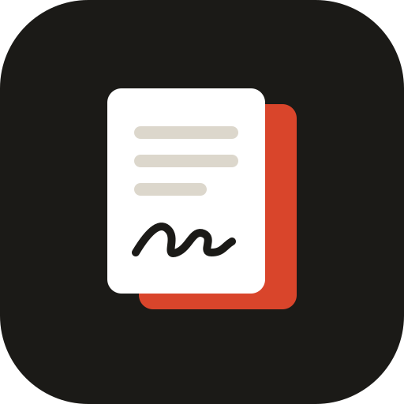
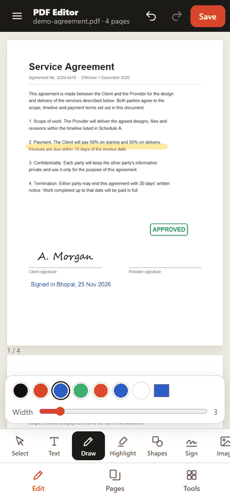
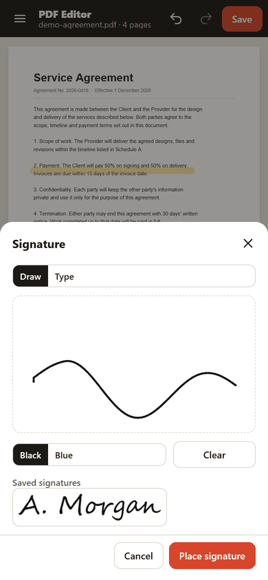
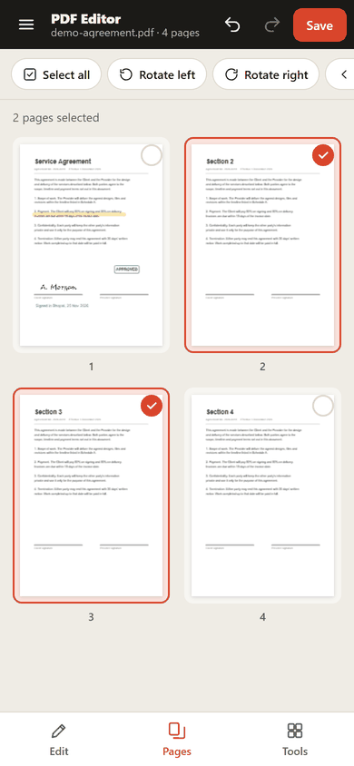
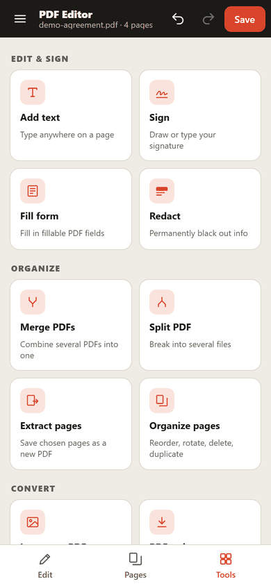

<div align="center">



# PDF Editor

**A free, open-source PDF editor for Android and the web.**
Edit, sign, fill, merge, split, compress and convert PDFs, 100% offline. Your files never leave your device.

[](https://github.com/krishnakantnagina/pdf-editor-app/releases/latest)
[](https://krishnakantnagina.github.io/pdf-editor-app/)
[](https://github.com/krishnakantnagina/pdf-editor-app/actions/workflows/android.yml)
[](https://github.com/krishnakantnagina/pdf-editor-app/actions/workflows/ci.yml)
[](LICENSE)
[](CONTRIBUTING.md)
[](https://github.com/krishnakantnagina/pdf-editor-app/stargazers)

&nbsp;
&nbsp;
&nbsp;


</div>

## Why PDF Editor?

- **Private.** Everything happens on your phone or computer. No uploads, no accounts, no ads, no trackers.
- **Works offline.** Once installed, it works with no internet connection.
- **Free forever.** No watermarks on your files, no page limits, no "Pro" version.
- **Small and fast.** Plain HTML, CSS and JavaScript, with pdf.js (Mozilla) and pdf-lib.

## Download

| Platform | How to get it |
| --- | --- |
| **Android** | Download the latest **APK** from [Releases](https://github.com/krishnakantnagina/pdf-editor-app/releases/latest), open it and tap **Install**. You may need to allow "Install unknown apps" for your browser or file manager. |
| **Any browser** | Open **<https://krishnakantnagina.github.io/pdf-editor-app/>**. On Android Chrome: menu ⋮ → *Install app*. On iPhone Safari: Share → *Add to Home Screen*. |

On Android, saved files go to **Documents/PDF Editor**. Tap **Share…** to send a file straight to WhatsApp, Gmail or Drive.

## Features

**Edit & sign**
- Add text (5 fonts, any size or colour, multi-line), then edit, move, resize, duplicate or delete it
- Draw freehand, highlight, and add shapes (box, circle, line, arrow; outline or filled)
- Signatures: draw or type them; recent ones are saved for reuse
- Insert images (photos, logos, stamps from your gallery)
- Stamps: APPROVED, PAID, DRAFT, today's date, or custom text
- Whiteout (cover mistakes) and **secure redaction**: redacted pages are flattened, so the hidden text is really removed
- Fill fillable PDF forms (text boxes, checkboxes, dropdowns, radio buttons), with an option to flatten

**Organize**
- Merge PDFs, insert PDFs or images anywhere
- Split (every N pages or custom ranges, downloaded as a ZIP), extract pages
- Reorder, rotate, duplicate, delete, insert blank pages, reverse order

**Convert & optimize**
- Images → PDF (A4 / Letter / original size, margins)
- PDF → JPG/PNG (72 / 150 / 300 dpi)
- Extract text (copy or download as .txt)
- Compress (strong / balanced / light, optional black & white)
- Watermark and page numbers (with live preview)
- Unlock password-protected PDFs (with the password)
- Edit title, author, subject, keywords

**App**
- Undo/redo for every edit, plus keyboard shortcuts on desktop (Ctrl+Z / Ctrl+Y / Ctrl+S / Delete)
- Android app with native saving, sharing and back-button support
- Installable web app that works offline, with drag & drop on desktop

## Build it yourself

**Web app** (no build step):

```bash
git clone https://github.com/krishnakantnagina/pdf-editor-app.git
cd pdf-editor-app
npx serve .            # or: python -m http.server 8000
```

**Android APK** (needs Node.js 20+, JDK 21 and the Android SDK):

```bash
npm install
npm run android:build  # APK in android/app/build/outputs/apk/debug/
```

Or run `npm run android:sync && npm run android:open` and press Run in Android Studio.

Every push builds an APK in [GitHub Actions](https://github.com/krishnakantnagina/pdf-editor-app/actions/workflows/android.yml). Pushing a tag like `v1.2.0` publishes a signed APK to Releases.

## How it works

```
index.html            app shell
css/style.css         mobile-first styles
js/app.js             UI, state, tools, undo/redo, Android save/share
js/annots.js          annotation model: geometry, drawing, rotation maths
js/core.js            pdf.js setup and page rendering
js/exporter.js        builds the final PDF with pdf-lib, compress, images→PDF
js/zip.js             tiny ZIP writer (for split / multi-image downloads)
sw.js                 service worker (offline cache)
android/              Capacitor Android project (the APK)
lib/                  pdf.js (Apache-2.0) and pdf-lib 1.17 (MIT), bundled for offline use
```

pdf.js renders the pages. Your edits are kept as a list of annotations on top, so every change can be undone. On save, pdf-lib copies the original pages and draws your edits into them. Text stays real, selectable text wherever possible.

## Known limits

- **Editing the PDF's original text** isn't possible yet. Use Whiteout plus Add text to replace words.
- **Adding** a password isn't supported (pdf-lib can't encrypt). Unlocking works.
- Compress, unlock and redaction turn the affected pages into images, so their text can't be selected afterwards.
- Hindi and other non-Latin text is supported, but it's saved as a sharp image rather than selectable text.
- Very large PDFs (hundreds of pages) work, but can be slow on low-end phones.

Want to fix one of these? See below.

## Contributing

Contributions of all sizes are welcome, from fixing a typo to building a new tool.

1. Read the [contributing guide](CONTRIBUTING.md).
2. Pick an issue labelled [`good first issue`](https://github.com/krishnakantnagina/pdf-editor-app/labels/good%20first%20issue) or [`help wanted`](https://github.com/krishnakantnagina/pdf-editor-app/labels/help%20wanted), or suggest your own idea in [Discussions](https://github.com/krishnakantnagina/pdf-editor-app/discussions).
3. Open a pull request. Every PR gets an APK build you can install and test.

Please follow the [Code of Conduct](CODE_OF_CONDUCT.md), and report security problems privately as described in [SECURITY.md](SECURITY.md).

If this app is useful to you, please **⭐ star the repo**. It helps other people find it.

## License

[MIT](LICENSE) © Krishnakant Nagina

Bundled libraries: [pdf.js](https://github.com/mozilla/pdf.js) (Apache-2.0) and [pdf-lib](https://github.com/Hopding/pdf-lib) (MIT). Their licenses are in `lib/`.
